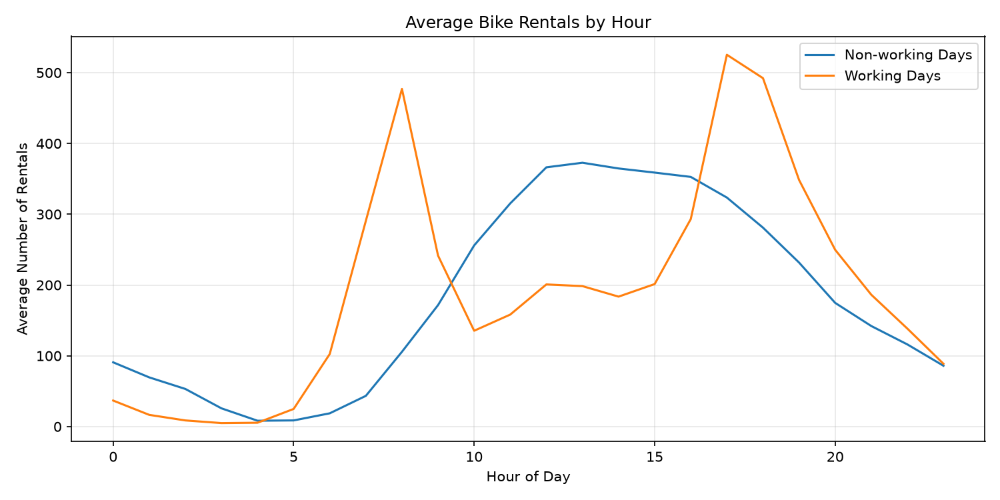
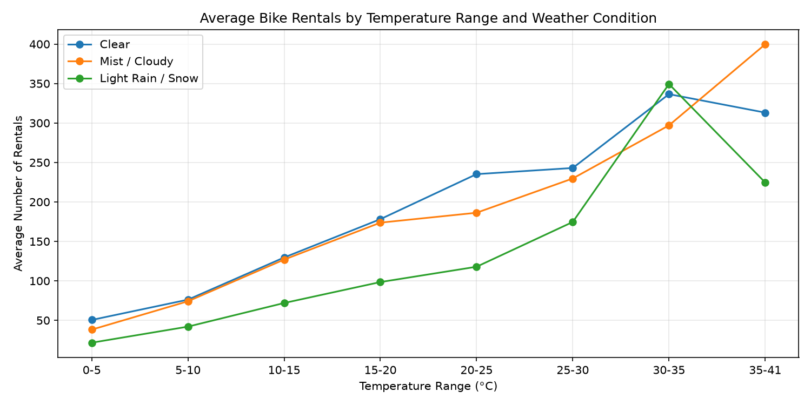
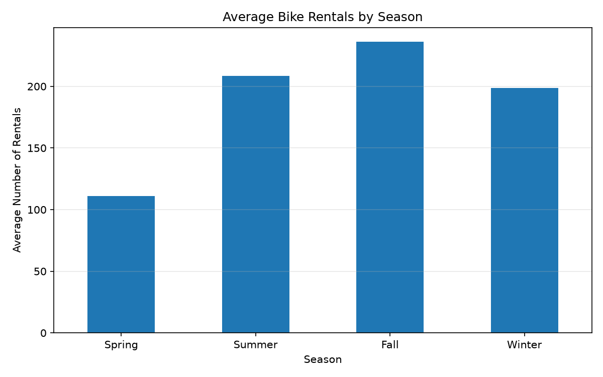
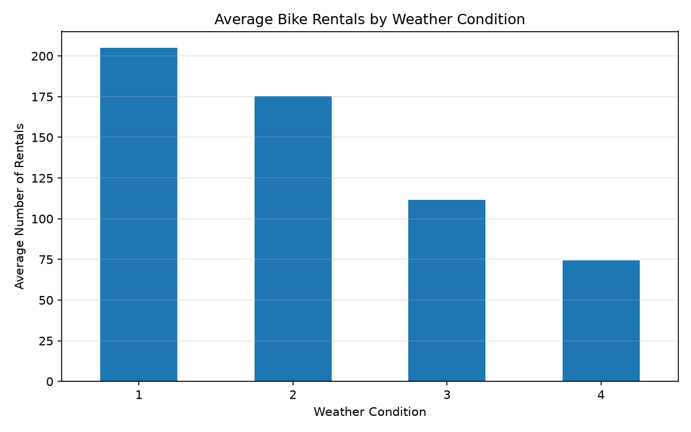

# Task 1 report: Exploratory Data Analysis

| Field | Value |
| --- | --- |
| Student | Marco Daniele Maiandi |
| Dataset | Bike Sharing — `hour.csv` (2011–2012) |
| Task | 1 — Exploratory Data Analysis |
| Tag / commit | `task1` — pending merge and tag |
| How to run | `uv sync`; `uv run python src/ai_mlops_hands_on_exercise/exploration.py` |
| Timebox | 2h - finished |

## 1. Summary

I explored 17,379 hourly bike-rental observations to identify demand patterns and data-quality issues. The dataset had no missing values, duplicate date-hour records or inconsistent rental totals. The IQR method flagged 505 high-demand hours (2.91%), which I retained because rush-hour peaks appear plausible. Temperature showed a moderate positive Pearson correlation with hourly rentals (*r* = 0.405); humidity showed a negative correlation (*r* = -0.323). Results for severe weather require caution because that category contains only three observations. These findings provide a basis for the interactive exploration app in Task 2.

**Evidence:** `src/ai_mlops_hands_on_exercise/exploration.py`; `figures/`.

## 2. Goal and success criteria

**Goal.** Load the data reproducibly, assess quality, study the target and relevant features, and explain findings with statistics and visualisations.

| Criterion | Target | Result |
| --- | --- | --- |
| Reproducible loading | Load hourly data from project files | Implemented |
| Data-quality assessment | Check missing values, duplicates, consistency and outliers | 0 missing; 0 date-hour duplicates; 0 mismatches; 505 potential outliers |
| Statistical exploration | Produce descriptive statistics and supported claims | Statistics, correlations and labelled charts produced |

**Evidence:** `exploration.py`; `figures/rental_distribution.png`.

## 3. Approach and key decisions

| Finding | Decision | Alternative considered | Where |
| --- | --- | --- | --- |
| Hourly data reveal time-of-day demand | Analyse `hour.csv` | Use daily totals only | `exploration.py`, data loading |
| 505 rental counts exceed the 642.5 IQR threshold | Retain and investigate peak hours | Delete all IQR outliers | `exploration.py`, outlier analysis |
| `casual + registered = cnt` for every row | Exclude these counts from future prediction features to avoid data leakage | Include them as predictors | `exploration.py`, consistency check |
| Weather category 4 has only 3 records | Interpret its mean cautiously | Compare category means without sample sizes | `exploration.py`, weather grouping |

No corrections were required for nulls, date-hour duplicates or rental-total mismatches. Temperature was converted from the normalised scale to Celsius for visualisation.

**Evidence:** `exploration.py`; `datasets/bike_sharing.zip`.

## 4. Results

| Finding | Value | Reference |
| --- | --- | --- |
| Target distribution | Mean 189.46; median 142; max 977 | 17,379 hourly records |
| Potential outliers | 505 (2.91%) | IQR upper threshold 642.5 |
| Pearson correlations with `cnt` | `temp` +0.405; `hum` -0.323; `windspeed` +0.093 | Correlation analysis |
| Working-day evening peak | ~525 average rentals at 17:00 | ~198 at 13:00 on working days |
| Weather category 1 vs 3 | ~205 vs ~112 average rentals | 11,413 vs 1,419 records |
| Highest seasonal average | Season 3: ~236 rentals/hour | Season 1: ~111 |

*Figure 1. Working-day rentals peak at approximately 525/hour at 17:00; non-working days peak at approximately 373/hour at 13:00.*

*Figure 2. At 35–41 °C, categories 2 and 3 contain only 25 and 3 observations, so the apparent crossovers of the lines are uncertain.*

*Figure 3: Average hourly rentals by season. Fall records the highest average (236.02 rentals/hour), while spring has the lowest (111.11 rentals/hour).*

*Figure: Average hourly rentals by weather category. Rentals decrease from 204.87 in category 1 to 111.58 in category 3.*

The target distribution is right-skewed. These findings are associations, not evidence that weather or temperature alone causes demand changes.

**Evidence:** `figures/hourly_rentals.png`; `figures/rental_distribution.png`; `figures/temperature_weather_vs_rentals.png`; `figures/season_vs_rentals.png`.

## 5. Problems and how you handled them

| Problem | Cause | Response | Status |
| --- | --- | --- | --- |
| Extreme rental counts | Rush-hour demand may be unusually high | Inspected top observations; retained plausible peaks | Analysed |
| Sparse severe-weather group | Only 3 observations | Reported counts alongside means | Documented |

**Evidence:** `exploration.py`.

## 6. Limitations and trade-offs

| Area | Limitation and impact | Next step |
| --- | --- | --- |
| Weather | Category 4's mean is based on 3 observations | Avoid generalising from it |
| Analysis | Pearson captures linear relationships but not confounding factors | Compare time, weather and workday together |
| Data | `casual` and `registered` reveal the target | Exclude from future predictors |
| Outliers | IQR flags some valid high-demand hours | Retain and reassess during modelling |

**Evidence:** `exploration.py`; `figures/temperature_weather_vs_rentals.png`.

## 7. Next steps

| Priority | Action | Why | Effort |
| --- | --- | --- | --- |
| 1 | Build an interactive data-exploration app | Reuse the Task 1 findings | M |
| 2 | Containerise, deploy and verify from a fresh clone | Meet Task 2 deployment and reproducibility goals | M |

**Evidence:** `part_1/part 1 analysis and deployment.md`.

## 8. Use of AI assistants

| Tool | Use | Where | Verification |
| --- | --- | --- | --- |
| ChatGPT | Coding suggestions, Matplotlib figure suggestions | `exploration.py`| Executed code, inspected printed results and figures |

**Evidence:** Development history.

## Checklist

- [x] `task1` tag pushed and updated above
- [x] Fresh-clone run confirmed
- [x] Repository checked for secrets, API keys and large unnecessary files
- [x] Every section includes an Evidence line
- [x] Every embedded figure includes a caption with a number
- [x] Guidance blocks removed
- [x] `AI_LOG.md` up to date
